# Czech Bank Dormant Account Analysis

**A SQL analysis in MySQL Workbench on over 1 million bank transactions: which accounts go quiet, and what did they look like before they did?**
[Full report: Czech Bank Dormant Analysis Report (PDF)](./Czech_bank_dormant_analysis_report.pdf)
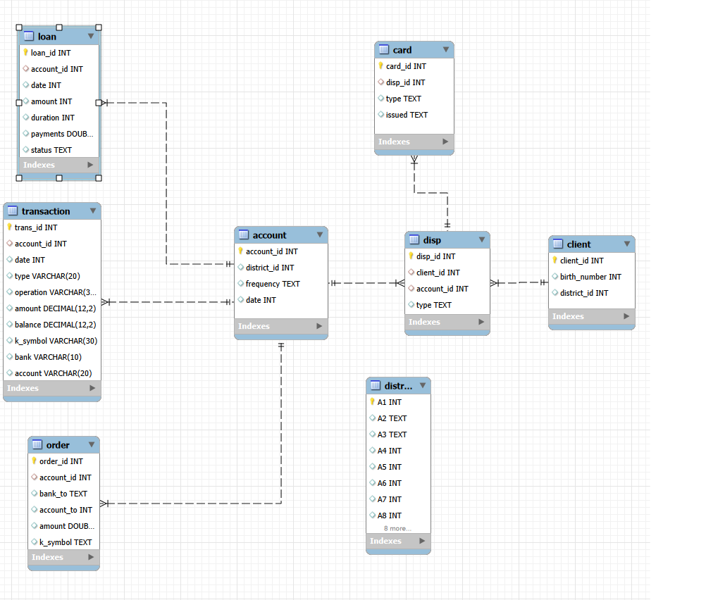

## Summary

I defined dormancy from scratch, because the data has no churn label, and used SQL to find the dormant accounts and compare them with active ones. 21 of the 4,500 accounts turned out to be dormant. Dormant accounts used far fewer of the bank's other services, and in their last 6 months they made fewer and smaller transactions that were mostly money going out.

## The problem

A retail bank can only act on a customer who is going quiet if it notices early enough. Most accounts don't close. They stop being used, and by the time that shows up, the customer has usually already moved their activity elsewhere. Spotting these accounts early gives the bank a chance to step in before they are lost.

The Czech Bank data has no churn label, so there is no column saying which accounts have gone dormant. The first problem is to define dormancy from the transactions themselves, and the definition has to hold up. A bank also posts interest, statement fees and sanction interest to accounts on its own, so those entries can't count as customer activity. The second problem is to find out what dormant accounts looked like in the months before they went quiet, so the next ones can be flagged sooner.

## Objectives

1. Understand the Czech Bank database and draw an entity relationship diagram.
2. Clean and transform the data for analysis in MySQL.
3. Identify dormant accounts, using customer activity only.
4. Analyse how dormant accounts behaved before going quiet, and compare them with active accounts.

## Dataset

The dataset is a collection of financial information from a Czech bank. It covers over 5,300 bank clients and approximately 1,000,000 transactions. The bank in the dataset has extended close to 700 loans and issued nearly 900 credit cards.

| Table | Description | Records |
| --- | --- | --- |
| `account` | Static characteristics of an account | 4,500 |
| `client` | Characteristics of a client | 5,369 |
| `disp` | Links a client to an account and describes their right to operate it | 5,369 |
| `order` | Permanent payment orders (debits only) | 6,471 |
| `trans` | One record per transaction on an account | 1,056,320 |
| `loan` | A loan granted for a given account | 682 |
| `card` | A credit card issued to an account | 892 |
| `district` | Demographic characteristics of a district | 77 |

## How I did it

### 1. Loading the data

- Seven tables were loaded with the MySQL Workbench Table Data Import Wizard.
- `trans` has over a million rows, so it was loaded with `LOAD DATA LOCAL INFILE` to make it faster. This needed `OPT_LOCAL_INFILE=1` in the connection settings to fix error 2068.

### 2. Cleaning and transforming

- Created `trans_clean` from `trans`, leaving the raw table untouched.
- Converted YYMMDD numbers into real dates.
- Translated the Czech codes (`type`, `operation`, `k_symbol`, statement frequency) into English labels.
- Turned blank values into NULL.
- Decoded the client `birth_number` into a birth date. For women the month has 50 added, so 50 is subtracted.
- Validated every step: row counts matched, dates had no NULLs and a sensible range, every code got a label, and blanks became NULL.

### 3. Defining a dormant account

A dormant account is one with **no customer activity for more than 90 days** as of 31 December 1998, the last transaction date in the data.

**Why 90 days:** A longer cutoff, such as 180 days, is the more common choice. But with 180 days, too few accounts would qualify, and a group that small is not enough to analyse or compare. The three bands (90-180, 180-365 and 365+) are still kept, so the longer cutoffs can be seen inside the group.

**What counts as customer activity:** every transaction a customer makes or sets up, except three entries the bank posts on its own:

| Excluded entry | Why |
| --- | --- |
| Interest credited | Added by the bank, not by the customer |
| Payment for statement | A fee charged by the bank |
| Sanction interest (negative balance) | A penalty charged by the bank |

These rows would make an unused account look active, since the bank keeps posting them.

### 4. Flagging dormant accounts

The `account_activity` view gives one row per account with its last customer activity date, days inactive and a status (Active, Dormant 90-180, Dormant 180-365, Dormant 365+). The result was saved as the `account_group` table, because the view was slow to recompute and the table made all later queries faster.

### 5. Comparing dormant and active accounts

Six views compare the two groups: account age, owner age, average transaction amount, and whether the account has a card, a loan or a standing order.

### 6. Behaviour before going quiet

An account usually changes its behaviour in the months before it goes quiet, so these views look only at the 6 months up to each account's last customer activity: the last transaction, activity per account, active against dormant, and debits against credits.

## SQL techniques

- **Window function:** `ROW_NUMBER() OVER (PARTITION BY ... ORDER BY ...)` to find each account's last customer transaction
- **CTEs** to split the logic into steps
- **`LEFT JOIN`** to keep accounts with no customer activity
- **Correlated `EXISTS` subqueries** to check for a card, a loan or a standing order
- **Conditional aggregation**, such as `SUM(type_en = 'Credit')`, to count credits and debits in one pass
- **Date functions:** `STR_TO_DATE`, `DATEDIFF`, `DATE_SUB`, `TIMESTAMPDIFF`
- **String functions** (`LEFT`, `RIGHT`, `SUBSTRING`, `CONCAT`, `LPAD`) to decode birth numbers
- **`IS NULL OR NOT IN (...)`** filters, because `NOT IN` alone would drop customer transactions with a NULL category
- **Views and a composite index** to keep the analysis reusable and fast

## Results

### Size of the problem

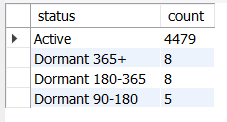

21 of the 4,500 accounts are dormant, split 5, 8 and 8 across the three bands.

### Dormant vs active

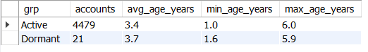
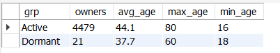
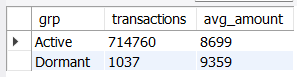
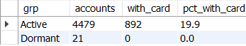
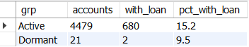
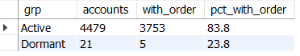

- **Account age:** Dormant accounts are slightly older (3.7 years on average against 3.4). Both groups range from about 1 to 6 years.
- **Owner age:** Dormant owners are younger (37.7 years on average against 44.1).
- **Average transaction amount:** Slightly higher for dormant accounts (9,359 against 8,699).
- **Card:** None of the 21 dormant accounts has a card, against 19.9% of active accounts.
- **Loan:** 9.5% of dormant accounts have a loan, against 15.2% of active accounts.
- **Standing order:** 23.8% of dormant accounts have a standing order, against 83.8% of active accounts.

Dormant accounts use the bank's other services far less than active accounts. The gap is clearest for standing orders and cards.

### Behaviour in the last 6 months

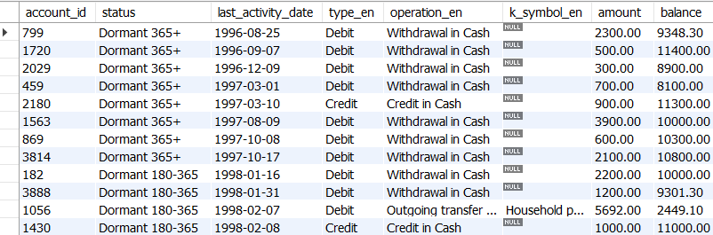
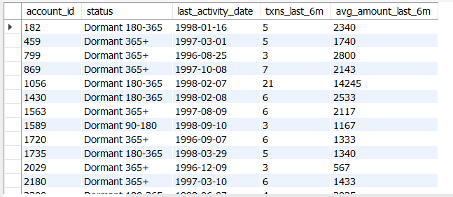
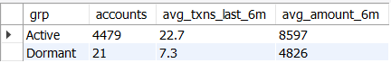
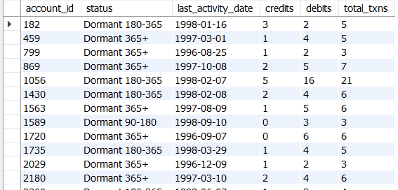
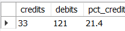

- **Transactions:** Dormant accounts averaged 7.3 customer transactions in their last 6 months, against 22.7 for active accounts. That is about a third as many.
- **Average amount:** Dormant accounts averaged 4,826 per transaction, against 8,597 for active accounts. That is about 44% lower.
- **Debits and credits:** Only 21.4% of the dormant accounts' transactions were credits (33 credits against 121 debits). Money was mostly going out, not coming in.

## Key findings

- Accounts that are about to go dormant make **fewer and smaller transactions** and are **mostly drawn down**. A bank could watch for this pattern as an early warning.
- Dormant accounts use **far fewer of the bank's other services** than active accounts.
- The last 6 months tell more than the full history. Over the whole history, dormant accounts had a higher average amount than active ones. In their last 6 months, it was much lower.

## Limitation

The dormant group is only 21 accounts, so a single account changes the percentages a lot. For example, the 9.5% with a loan is just 2 accounts. These results show a pattern in this data and shouldn't be taken as a firm rule.

## Tools

MySQL, MySQL Workbench

<!-- Add your name, LinkedIn and email here -->
